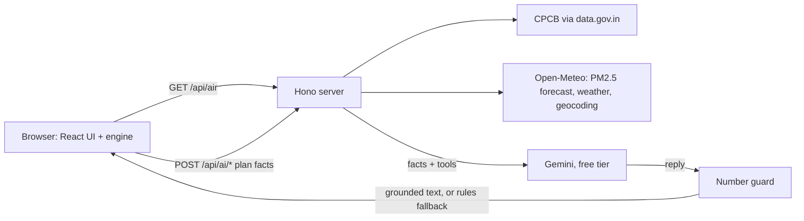

# Saans Ghar · a breathing plan for the whole family

**Live:** https://saansghar.rahulrao.in · **Challenge:** PromptWars Virtual 6, "Urban Air Quality Assistant"

Saans Ghar (Hindi: "breath home") turns the live CPCB reading at your nearest monitoring station into a plan for each person in your family. It says when the child should play, when grandmother should walk, how the commute should go, and **how many micrograms of PM2.5 each change saves that person**. Every number comes from code; Gemini only explains, translates and answers questions about those numbers.

## What it does

| Feature                     | How                                                                                                                                                                                                                                                                                                 |
| --------------------------- | --------------------------------------------------------------------------------------------------------------------------------------------------------------------------------------------------------------------------------------------------------------------------------------------------- |
| **Live air, sourced**       | Nearest CPCB station (data.gov.in feed) within 25 km. We compute the Indian NAQI ourselves from the pollutant sub-indices and show the station, distance and IST timestamp. With no station nearby, the Open-Meteo (CAMS) model is used and labelled "Modelled".                                    |
| **Day plan**                | Each routine (school run, walk, play, commute) moves to the cleanest allowed hour in its window, or is shortened, moved indoors or done with an N95. Children, older adults and sensitive members get lower limits. Sections run _This morning → Tomorrow morning_, so the plan always looks ahead. |
| **Why + impact**            | Each tip shows the PM2.5 index at the usual vs the advised hour, the weather reason (mixing-layer depth) when there is one, and the **dose saved**: concentration × breathing rate for age and activity (US EPA EFH 2011) × minutes.                                                                |
| **Home air**                | Single-room indoor model (penetration, air changes by window habit, settling, purifier CADR), AHAM purifier sizing, the best hour to air out, and swaps for indoor smoke (mosquito coils, incense, frying, dry sweeping) with evidence.                                                             |
| **Photo reading**           | Snap a monitor or purifier display; Gemini reads the PM2.5 number (JSON schema + zod), **you confirm it**, and the app compares indoor vs outdoor. Photos are downscaled and EXIF-stripped in the browser and never stored.                                                                         |
| **Travel switches**         | Same trip by each mode: what you breathe and what you emit (approximate factors, labelled).                                                                                                                                                                                                         |
| **Society / school notice** | Code makes the call (NAQI band, plus the GRAP-stage level in Delhi-NCR); Gemini words it in English, Hindi or Marathi; copy or share to WhatsApp.                                                                                                                                                   |
| **Ask**                     | Gemini **function calling** over our own tools (`air_now`, `forecast_window`, `member_plan`, `inhaled_dose`).                                                                                                                                                                                       |
| **Weekly ledger**           | "Your family avoided ~X µg this week", stored only in this browser.                                                                                                                                                                                                                                 |
| **Light + dark**            | Aurora (white, blue, orange) and Voltage (black, yellow, green) themes; 375 px mobile layout.                                                                                                                                                                                                       |

## Responsible AI: the number guard

The model never produces a figure. Code computes the facts; the prompt says to use only those; then `server/ai/guard.ts` extracts every number written in digits (Devanagari digits included) and **rejects the reply if any of them is not in the facts or tool results**, or if it spells a number out in words (English, Hindi or Marathi). A rejected or failed reply falls back to the built-in rules text, labelled "Built-in explanation". The whole app works with **no Gemini key at all**.

## Architecture



- `src/engine/`: pure, tested functions (NAQI, dose, plan, indoor, switches, notice, ledger). The same engine runs in the browser and on the server.
- `server/`: data adapters with a stale-while-failing cache (data.gov.in often returns 502), the API, AI tasks and the guard.
- `src/components/`: render only.

## Requirement → code → test

| Brief / explainer asks for          | Code                                                                   | Tests                                                        |
| ----------------------------------- | ---------------------------------------------------------------------- | ------------------------------------------------------------ |
| Real-time data with source and time | `server/sources/cpcb.ts`, `server/air.ts`, `src/components/AirNow.tsx` | `tests/server/cpcb.test.ts`, `tests/server/air.test.ts`      |
| Any Indian location                 | `server/places.ts`, `src/components/PlacePicker.tsx`                   | `tests/server/places.test.ts`                                |
| Personalised per family member      | `src/engine/plan.ts`, `src/engine/household.ts`                        | `tests/engine/plan.test.ts`                                  |
| Morning / afternoon / evening plan  | `src/engine/schedule.ts`, `src/components/PlanView.tsx`                | `tests/engine/schedule.test.ts`                              |
| "Why" and the impact of each choice | `src/engine/dose.ts`, `src/engine/why.ts`, `src/engine/explain.ts`     | `tests/engine/explain.test.ts`, `tests/engine/why.test.ts`   |
| Indoor guidance                     | `src/engine/indoor.ts`, `src/components/HomeView.tsx`                  | `tests/engine/indoor.test.ts`                                |
| GenAI, grounded                     | `server/ai/*`, `server/aiRoutes.ts`                                    | `tests/server/ai-*.test.ts`, `tests/server/aiRoutes.test.ts` |
| Works without AI                    | rules fallbacks in `src/engine/answer.ts`, `src/engine/explain.ts`     | `e2e/app.spec.ts` (runs with no key)                         |
| Accessible, mobile                  | `src/styles/app.css`, `src/components/Tabs.tsx`                        | `e2e/app.spec.ts` (axe, both themes, desktop + Pixel 7)      |

## Run it

```bash
npm ci
cp .env.example .env        # add DATA_GOV_API_KEY (free) and optionally GEMINI_API_KEY (free AI Studio key)
npm run build
npm run start:local         # http://localhost:8787
```

Without `DATA_GOV_API_KEY` the app uses the Open-Meteo model and says so. Without `GEMINI_API_KEY` every AI feature answers from the rules, except photo reading, which asks you to type the number. Docker: `docker build -t saans-ghar . && docker run -p 8080:8080 --env-file .env saans-ghar`.

## Quality gates

`npm run check` runs typecheck, ESLint (strict type-checked, jsx-a11y, complexity ≤ 10, ≤ 40 lines per logic function, no magic numbers in logic files; components and cited data tables are exempt), unused-code detection (knip), duplicate-code detection (0 allowed), Prettier and Vitest with coverage thresholds. `npm run e2e` runs Playwright on desktop and Pixel 7 with axe checks in both themes. CI runs both on every push. See [TESTING.md](TESTING.md), [SECURITY.md](SECURITY.md) and [ACCESSIBILITY.md](ACCESSIBILITY.md). Sample households for evaluators: [SAMPLE_INPUTS.md](SAMPLE_INPUTS.md).

## Privacy

No accounts. The family, routines and weekly ledger stay in the browser. The server gets the chosen coordinates for the air lookup and rounds them to about 1 km. Pressing an AI button sends first names, routine labels, the area name and the air numbers (never coordinates) to Google Gemini; the app says so next to each button.

## Data sources and licences

- **CPCB real-time AQI** via [data.gov.in](https://data.gov.in) (Government Open Data Licence – India). The feed publishes pollutant sub-indices; we convert them back to concentrations with the CPCB breakpoints for the dose maths.
- **Open-Meteo** air quality (CAMS), weather and geocoding (CC BY 4.0).
- NAQI breakpoints: CPCB, 2014. Breathing rates: US EPA Exposure Factors Handbook 2011, Table 6-2. Purifier sizing: AHAM. Mosquito-coil evidence: Liu et al., 2003 (EHP).

## Known gaps (honest list)

- The forecast is the CAMS model scaled to the station's current reading: it keeps the model's shape, not a local forecast. It is labelled "estimated trend".
- In-vehicle exposure shares and CO₂ factors are mid-range literature values; real trips vary widely.
- Masks are advised but never credited with a dose saving, because real-world fit varies too much.
- The GRAP stage shown is the level the AQI matches, not an official order.
- The rules fallback is English-only; Hindi and Marathi need Gemini.
- CPCB stations sometimes stop reporting for hours; the app shows how old the reading is when it is over 2 hours.

Advice is general guidance, not medical advice. MIT licence.
