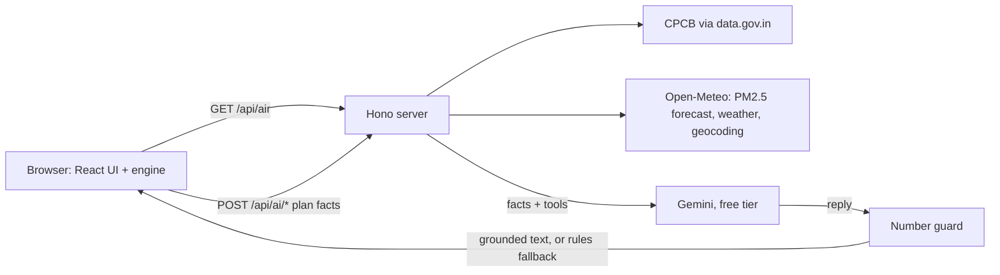

# Saans Ghar · a breathing plan for the whole family

**Live:** https://saansghar.rahulrao.in · **Challenge:** PromptWars Virtual 6, "Urban Air Quality Assistant"

Saans Ghar (Hindi: "breath home") turns the live CPCB reading at your nearest monitoring station into a plan for each person in your family. It says when the child should play, when grandmother should walk and how the commute should go, and it shows **how many micrograms of PM2.5 each change saves that person** and **how much CO₂ a cleaner trip avoids**. Every number comes from code. Gemini explains, translates and answers questions about those numbers, and a number guard rejects any reply that adds one of its own.

## Chosen Vertical

**Challenge 6: Urban Air Quality Assistant.**

> Create a GenAI-powered assistant that helps families and communities navigate severe winter smog and urban air pollution. The application should suggest low-emission daily routines, indoor air quality hacks, and sustainable alternatives tailored to their location and lifestyle, while clearly explaining the direct impact of their choices.

**Who it is for:** Indian households with children, older adults or someone with asthma, heart or lung conditions, and the housing societies and schools they belong to. **Why it matters:** in winter the same city can swing from "Satisfactory" to "Very Poor" within a day, and the cleanest hour is often not the habitual one. Moving a walk by a few hours, or a commute to the metro, cuts what each person breathes far more than most families realise.

## Challenge Alignment

Every clause of the brief, where it shows up in the app, and the code and tests behind it. Full traceability: [PROBLEM_ALIGNMENT.md](PROBLEM_ALIGNMENT.md).

| Brief clause                                    | What the app does                                                                                                                                   | Code                                                                  | Tests                                                                   |
| ----------------------------------------------- | --------------------------------------------------------------------------------------------------------------------------------------------------- | --------------------------------------------------------------------- | ----------------------------------------------------------------------- |
| GenAI-powered assistant                         | Gemini explains the plan (English, Hindi, Marathi), answers questions with **function calling**, writes the society notice and reads monitor photos | `server/ai/*`, `server/aiRoutes.ts`                                   | `tests/server/ai-*.test.ts`, `tests/server/aiRoutes.test.ts`            |
| families                                        | Members with age group (child, adult, older adult) and a sensitive flag; each gets their own advice and limits                                      | `src/engine/plan.ts`, `src/components/FamilyEditor.tsx`               | `tests/engine/plan.test.ts`, `tests/components/FamilyEditor.test.tsx`   |
| communities                                     | Society / school notice: code makes the outdoor-play call (NAQI band, Delhi-NCR GRAP level); share to WhatsApp                                      | `src/engine/notice.ts`, `src/components/ShareView.tsx`                | `tests/engine/notice.test.ts`, `tests/components/ShareView.test.tsx`    |
| severe winter smog and urban air pollution      | Live CPCB station NAQI with station, distance and IST time; 24-hour PM2.5 trend; mixing-layer (inversion) reason on each moved routine              | `server/sources/cpcb.ts`, `server/air.ts`, `src/engine/why.ts`        | `tests/server/cpcb.test.ts`, `tests/engine/why.test.ts`                 |
| low-emission daily routines                     | Each routine moves to its cleanest hour; trip routines also show their **low-emission option** (CO₂ saved per trip, without breathing more)         | `src/engine/plan.ts`, `src/engine/greener.ts`                         | `tests/engine/plan.test.ts`, `tests/engine/greener.test.ts`             |
| indoor air quality hacks                        | Indoor estimate, purifier sizing (AHAM), best hour to air out, smoke-source swaps, photo reading of a monitor                                       | `src/engine/indoor.ts`, `src/components/HomeView.tsx`                 | `tests/engine/indoor.test.ts`, `tests/components/HomeView.test.tsx`     |
| sustainable alternatives                        | Same trip by every mode: minutes, PM2.5 breathed and CO₂ emitted                                                                                    | `src/engine/switches.ts`, `src/components/TravelView.tsx`             | `tests/engine/switches.test.ts`, `tests/components/TravelView.test.tsx` |
| tailored to their location and lifestyle        | Any Indian place (CPCB station search, geocoding, device location); each member's own routines, times, effort and flexibility                       | `server/places.ts`, `src/state/household.ts`                          | `tests/server/places.test.ts`, `tests/state/household.test.ts`          |
| clearly explaining the direct impact of choices | Every tip: index at usual vs advised hour, the weather reason, **µg of PM2.5 saved**; weekly total of planned savings                               | `src/engine/dose.ts`, `src/engine/explain.ts`, `src/engine/ledger.ts` | `tests/engine/explain.test.ts`, `tests/state/derive.test.ts`            |

## Approach and Logic

1. **Measure, don't guess.** Air comes from the nearest CPCB station (data.gov.in). The feed publishes pollutant sub-indices, so we convert them back to concentrations with the CPCB breakpoints and compute the NAQI ourselves. With no station within 25 km, the Open-Meteo (CAMS) model is used and labelled "Modelled".
2. **Shape from the model, level from the station.** The CAMS hourly PM2.5 forecast is scaled so the current hour matches the station (models under-read Indian winter smog: Delhi, 23-Nov-2026, model 72 vs station 247 µg/m³). It is labelled "estimated trend".
3. **Plan each routine.** For every member's routine, find the cleanest start within the hours the family accepts, then decide: go, shorten, N95 (for trips that can't be skipped) or indoors. Children, older adults and sensitive members get lower limits.
4. **Count the impact.** Dose = PM2.5 × breathing rate for age and activity (US EPA Exposure Factors Handbook 2011) × minutes. Trips add CO₂ per passenger-km by mode. Masks are advised but never credited with a saving.
5. **Let the AI word it, not decide it.** Code computes every fact. Gemini gets the facts (or calls tools that return them), and the number guard drops any reply containing a number that is not in them.

Key trade-offs are recorded in [docs/build-log.md](docs/build-log.md).

## How the Solution Works



**User journey:** pick a place (search, location or a sample family) → see the air now, its source and the next 24 hours → **Today**: the plan by morning, afternoon, evening and tomorrow, each tip with its saving → **Family**: edit members and routines → **Home air**: room, purifier, airing hour, photo reading → **Travel**: compare modes → **Share**: the society notice → **Ask**: questions in English, Hindi or Marathi.

### Directory organisation

```
src/engine/      pure functions: NAQI, dose, plan, indoor, switches, greener, notice, ledger, explanations
src/schemas/     zod schemas shared by browser and server
src/state/       household storage, derived plan, data hooks
src/components/  React views (render only)
server/sources/  CPCB and Open-Meteo adapters (injected fetch, validated)
server/ai/       Gemini adapter, prompts, tools, tasks, number guard
server/          air service, stale-while-failing cache, HTTP guards, routes
tests/           Vitest: engine, server, AI, state, components
e2e/             Playwright + axe, desktop and Pixel 7
```

### Endpoints

| Method | Path               | Purpose                                                    |
| ------ | ------------------ | ---------------------------------------------------------- |
| GET    | `/api/health`      | Station count, cache state, whether AI is enabled          |
| GET    | `/api/places?q=`   | CPCB stations, then places, matching a search (India only) |
| GET    | `/api/air?lat&lon` | NAQI, station, PM2.5, calibrated forecast, weather         |
| POST   | `/api/ai/explain`  | Plan explanation in a language (Gemini or rules)           |
| POST   | `/api/ai/ask`      | Question answered with function calling (Gemini or rules)  |
| POST   | `/api/ai/notice`   | Society / school notice; the call is made by code          |
| POST   | `/api/ai/read`     | PM2.5 read from a monitor photo (Gemini, user confirms)    |

### Quick start

```bash
npm ci
cp .env.example .env        # DATA_GOV_API_KEY (free) and optionally GEMINI_API_KEY (free AI Studio key)
npm run build
npm run start:local         # http://localhost:8787
```

Without `DATA_GOV_API_KEY` the app uses the Open-Meteo model and says so. Without `GEMINI_API_KEY` every AI feature answers from the rules, except photo reading, which asks you to type the number. Docker: `docker build -t saans-ghar . && docker run -p 8080:8080 --env-file .env saans-ghar`. Sample households for evaluators: [SAMPLE_INPUTS.md](SAMPLE_INPUTS.md).

## How GenAI Is Used

- **Model:** Gemini (`gemini-3.5-flash-lite` on the free AI Studio tier, set by `GEMINI_MODEL`) through `@google/genai` ([server/ai/model.ts](server/ai/model.ts)).
- **Four tasks:** explain the plan; answer questions with **function calling** over `air_now`, `forecast_window`, `member_plan` and `inhaled_dose`, each running our own code ([server/ai/tools.ts](server/ai/tools.ts)); word the society notice around a decision code already made; read a PM2.5 number from a photo with **structured JSON output** validated by zod, which the user confirms.
- **Prompts:** fixed system prompts ([server/ai/prompts.ts](server/ai/prompts.ts)) plus a user message of code-computed facts, with clock times added so the model never converts hours.
- **Guardrails:** the number guard ([server/ai/guard.ts](server/ai/guard.ts)) rejects a reply with any digit-written number not in the facts or tool results (Devanagari digits included) or any number spelled as a word in English, Hindi or Marathi. Names and labels are passed as JSON data, never as instructions. Rate limit 12 AI calls a minute per client; each Gemini try times out after 8 s and is retried up to three tries in all, then the rules answer is shown.
- **Fallback:** a rejected, failed or slow reply is replaced by the built-in rules text, labelled "Built-in explanation". The app works fully with no key.
- **Building it:** the tools, prompt evolution and who did what are in [docs/build-log.md](docs/build-log.md).

## Code Quality

- TypeScript `strict` with `noUncheckedIndexedAccess` and `exactOptionalPropertyTypes`; no `any`.
- ESLint `strictTypeChecked` + jsx-a11y + react-hooks + jsdoc: complexity ≤ 10, nesting ≤ 3, ≤ 4 parameters, ≤ 200 lines per file, ≤ 40 lines per logic function, no magic numbers in logic files, a doc comment on every export.
- Duplicate code threshold 0 (jscpd); no unused files, exports or dependencies (knip); one Prettier format.
- A pure engine (`src/engine/`) with time passed in, adapters and AI behind injectable interfaces, and one composition root.
- Small conventional commits. Details: [CODE_QUALITY.md](CODE_QUALITY.md).

## Security

- Strict Content Security Policy (`default-src 'self'`, no `unsafe-inline`), HSTS, `X-Frame-Options: DENY`, `nosniff`, strict referrer and permissions policy.
- Every non-GET request must come from the same origin; every request body, query and upstream response is validated with zod.
- Rate limits (60 a minute, 12 for AI) and body limits (8 KB, 32 KB for AI, 1 MB for photos); upstream timeouts.
- API keys stay on the server; the container runs as a non-root user; CodeQL, dependency review and `npm audit` in CI; `/.well-known/security.txt`.
- AI safety: facts passed as data, read-only tools, the number guard, user confirmation for photo readings. Details: [SECURITY.md](SECURITY.md).

## Efficiency

- One national CPCB download shared by every visitor (30-minute cache), stale-while-failing, with in-flight request de-duplication; forecasts cached for an hour per ~1 km point.
- `Cache-Control` on lookups, `immutable` hashed assets, Brotli and gzip precompressed at build time.
- Bundle budget enforced in CI (130 KB JavaScript, 8 KB CSS, gzip); one self-hosted font weight; only the open tab renders; photos shrunk on the device. Details: [EFFICIENCY.md](EFFICIENCY.md).

## Testing

- **399 Vitest tests in 50 files**, with a **100% gate on statements, branches, functions and lines** (as of 24-Nov-2026; `npm run coverage` prints the live figures).
- One test file per engine module, plus server adapters with fake fetch, the AI layer with a fake model (guard, tool loop, fallbacks), state hooks and every component with Testing Library.
- **16 Playwright tests** on desktop Chrome and a Pixel 7 against the production build with no API keys, including axe in both themes and no sideways scroll from 228 px to 768 px.
- No test touches the network. Details: [TESTING.md](TESTING.md).

## Accessibility

- WCAG 2.1 AA: axe reports 0 violations in light and dark, on every tab, on desktop and phone.
- WAI-ARIA tabs with arrow keys, a skip link, visible focus, `aria-live` for status and AI replies, and `lang` on Hindi and Marathi replies.
- Colour is never the only signal (band names beside CPCB colours); text contrast ≥ 4.5:1; 44 px tap targets; reduced motion respected. Details: [ACCESSIBILITY.md](ACCESSIBILITY.md).

## Assumptions Made

- The nearest CPCB station within 25 km represents the household's outdoor air; beyond that the modelled value is used and labelled.
- The forecast keeps the CAMS model's shape and takes its level from the station; it is labelled "estimated trend", not a local forecast.
- Breathing rates are age-group means (US EPA EFH 2011): child 3–6 years, adult 21–31, older adult 61–71.
- Indoor air uses a single well-mixed room model with mid-range literature values (penetration 0.8, air changes by window habit, settling 0.2/h).
- In-vehicle exposure shares and CO₂ per passenger-km are mid-range literature values; real trips vary widely.
- Masks are advised but never credited with a saving, because real-world fit varies too much.
- The GRAP stage shown is the level the AQI matches, not an official order.
- The rules fallback is English only; Hindi and Marathi need Gemini.
- CPCB stations sometimes stop reporting for hours; the app says how old a reading is once it is over 2 hours.

## Privacy

No accounts. The family, routines and weekly ledger stay in the browser. A device location is rounded to about 1 km in the browser before it is saved or sent, and the server rounds every point the same way. Pressing an AI button sends first names, routine labels, the area name and the air numbers (never coordinates) to Google Gemini; the app says so next to each button.

## Data Sources and Licences

- **CPCB real-time AQI** via [data.gov.in](https://data.gov.in) (Government Open Data Licence – India).
- **Open-Meteo** air quality (CAMS), weather and geocoding (CC BY 4.0).
- NAQI breakpoints: CPCB, 2014. Breathing rates: US EPA Exposure Factors Handbook 2011, Table 6-2. Purifier sizing: AHAM. Mosquito-coil evidence: Liu et al., 2003 (EHP).

Advice is general guidance, not medical advice. Code under the [MIT licence](LICENSE).
